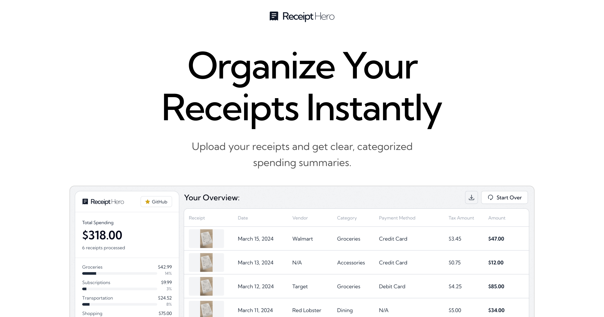

<a href="https://github.com/abdtriedcoding/receipthero">
  
  <h1 align="center">Slipwise</h1>
</a>

  An open source receipt management app with AI-powered OCR. Powered by Cohere.

## Tech stack

- Next.js app router with Tailwind CSS
- Cohere Command A Vision for receipt data extraction
- shadcn/ui components with Radix UI
- Zod for data validation

## How it works

1. Upload receipt images via drag & drop or file selection
2. Send images to Cohere's Command A Vision model for OCR processing
3. Extract structured data: vendor, date, amount, items, currency, payment method
4. Automatically categorize expenses (groceries, dining, gas, etc.)
5. Display spending breakdown and receipt management interface
6. Store data locally in browser for privacy

## Cloning & running

1. Clone the repo: `git clone https://github.com/abdtriedcoding/receipthero.git`
2. Create a [Cohere API key](https://dashboard.cohere.com/api-keys)
3. Create a `.env.local` file (use `.example.env` for reference) and set `COHERE_API_KEY`
4. Run `npm install` and `npm run dev` to install dependencies and run locally
